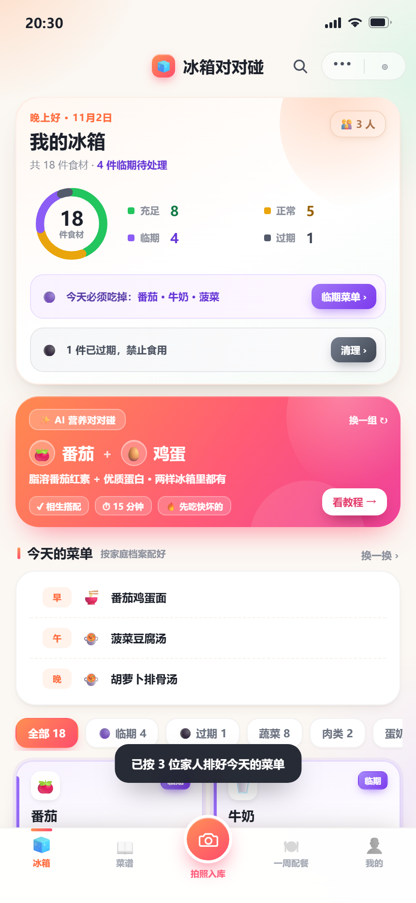

# 冰箱对对碰 · 网页版 Demo

> AI 全生命周期家庭食材管理。注册建家庭档案 → 拍照入库 → 四色保质期分级 → 营养对对碰 → 视频对照做菜 → 剩余食材二次更新 → 一周配餐 → 周末聚餐定制补货，一整个闭环都能点。



纯前端实现，**不需要装任何依赖**：双击 `index.html` 就能跑（也可以用本地服务器打开，见下）。

---

## 一、怎么运行

**方式 A：直接双击**

打开 `index.html` 即可。Chrome / Edge / Safari 都行。

**方式 B：本地服务器（推荐，localStorage 更稳）**

```powershell
cd E:\deepseek\fridge-pair
python -m http.server 8848
```

然后访问 <http://127.0.0.1:8848/>。

> 手机上想试：把电脑和手机连同一个 Wi-Fi，手机浏览器打开 `http://电脑IP:8848/`，页面会自动铺满全屏。

---

## 二、3 分钟答辩演示脚本

| 步骤 | 操作 | 讲解重点 |
|---|---|---|
| 1 | 打开 App | 未登录时「我的」就是**登录页**：手机号 + 验证码（演示码固定 `123456`），也可「先看看演示」 |
| 2 | 登录后 | **家里有几口人**：点 1~8 直接生成对应人数，再填称呼 / 角色 / 性别 / 年龄 |
| 3 | 进入首页 | 四色环形图（8 充足 / 5 正常 / **4 临期** / 1 过期）+ 按家庭档案排好的「今天的菜单」早/午/晚 |
| 4 | 点「临期菜单 ›」 | 只挑能用临期食材做的菜，并标「现在能做 / 缺几样」 |
| 5 | 菜谱 →「视频做菜」 | **独立的视频页**：点封面站内播放 B 站视频，其余菜品一键去 B站/抖音/小红书搜同款 |
| 6 | 点「开始做菜」 | 按配方自动扣库存，剩多少一目了然 ← 别人没有的闭环 |
| 7 | 弹窗点「📷 拍剩余量」 | 二次拍照，AI 给剩余比例，拖滑块改，确认后库存真的变 |
| 8 | 底部「拍照入库」→「用示例图」 | 无摄像头也能演：识别框 + 置信度 + 改数量 + 一键入库 |
| 9 | 顶部放大镜 | **全局搜索**：一个输入框同时搜菜谱 / 冰箱食材 / 视频，输入「番茄」三类结果一起出 |
| 10 | 配餐 → 生成一周 | 7 天 × 三餐，临期食材排在今天/明天，每天带营养备注 |
| 11 | 聚餐规划 | 选**本周五 + 2男2女1小孩 + 川菜**，还能手输「**水煮鱼、番茄炒蛋**」和口味「**微辣**」→ 一桌菜 + 缺什么买多少 |
| 12 | 聚餐结果 | 点名的「番茄炒蛋」会排进菜单；库里没有的「水煮鱼」单列出来，并给三个平台搜做法的入口 |
| 13 | 我的 → 时间旅行 +7 天 | 卡片当场变紫变黑，**四色是动态算的**，不是写死的标签 |
| 14 | 我的 → 退出登录 | 回到登录页，登录态与家庭档案都还存在本机 |

第 12 步是杀手锏：时间一推，冰箱整体从「绿多」变「黑多」。

---

## 三、功能对照

| 方案功能 | 实现位置 | 是否可交互 |
|---|---|---|
| ① AI 拍照入库（生鲜+包装） | 底部相机按钮 | ✅ 选照片 / 示例图，识别框、置信度、数量可改 |
| ② 四色保质期分级 | 首页环形图 + 每张食材卡 | ✅ 按剩余天数实时计算，随时间自动变色 |
| ③ 营养相生相克 | 首页 AI 卡 + 菜谱「相生相克」 | ✅ 9 组规则，命中当前库存会标「冰箱里有」 |
| ④ 下厨房级教程 | 菜谱详情 | ✅ 用量 / 预处理 / 分步（含火候）/ 小贴士 / 营养 |
| ⑤ 剩余食材二次更新 | 食材详情「📷 拍剩余量」 | ✅ AI 估剩余比例 → 改库存 → 重新匹配菜谱 |
| ⑥ 家庭个性化一周食谱 | 配餐页「立即生成」 | ✅ 按成员结构排菜，临期优先，7×3 餐 |
| ⑦ 聚餐规划 + 自动补货 | 配餐页「开启聚餐规划」 | ✅ 一桌菜 + 缺料清单 + 采购清单 + 已购入库 |

### v5 新增（这次的一整轮扩充）

| 方向 | 做了什么 |
|---|---|
| **数据量** | 食材 22 → **254 种**（含蔬果肉禽/水产/豆制品/主食/调味/零食冷冻），菜谱 12 → **58 道**，覆盖 **12 个菜系** |
| **营养** | 每餐**雷达图 + 五项达标率**（热量/蛋白/钙/铁/维C），按家人年龄折算目标 |
| **做饭体验** | 步骤旁**一键计时器**（解析"煎 3 分钟"，到点响铃）；每步**语音朗读**、整篇朗读 |
| **缺料处理** | 缺食材直接给**替换建议**（牛里脊→鸡胸肉），并能**一键加入采购清单** |
| **对话助手** | 右下角「问冰箱」：今晚吃什么 / 什么快坏了 / 该买什么 / 怎么做番茄炒蛋，带可点选的快捷回复 |
| **周报** | 冰箱体检：做菜顿数、挽回金额、浪费率、下周建议 |
| **分区** | 食材按 **冷藏 / 冷冻 / 常温** 筛选，入库按食材推荐存放位置 |
| **过敏原** | 家人可标记过敏原，相关菜谱在排餐时自动排除，详情页会告警 |
| **预算** | 聚餐可填预算，超了自动去掉最贵的菜并说明 |
| **其他** | **深色模式**、**PWA**（可添加到手机桌面、离线可用）、**数据导出 JSON** |

### v8 新增

| 方向 | 做了什么 |
|---|---|
| **真实菜价** | 接入农业农村部 **2026-11-02 全国批发均价**（28 种蔬菜均价 4.04 元/kg、猪肉 15.15 元/kg 等），按「批发价 × 每单位重量 × 1.6 零售系数」折算成单价，覆盖 24 个常见食材；食材详情显示行情来源，菜谱详情显示**这道菜的食材成本** |
| **过敏原** | 家庭档案里可多选 乳/蛋/豆/海鲜/麸质/坚果；排餐自动排除相关菜，菜谱详情顶部告警、食材行标注「含海鲜」 |
| **疾病史** | 可多选 高血压/高血脂/糖尿病/痛风/肾病/胃病；命中禁忌食材的菜直接不排（如痛风→海鲜内脏、高血压→腌制品、糖尿病→高糖菜），口味类标签降权 |
| **健康档案入口** | 「我的 → 健康档案」「配餐 → 家庭档案 → 🩺 健康档案」两处直达，独立页面里改过敏原/疾病史/忌口，并实时显示"会避开 N 道菜" |
| **聚餐不重复** | 每次生成同一桌菜会加入随机扰动，并降低上一桌菜品的权重，所以「换一桌」真的会换 |
| **添加菜谱** | 菜谱页顶部「＋ 添加菜谱」：输入库里没有的菜名 →「搜索 / 生成」→ 按名字自动推断主料、烹饪方式，生成食材/步骤/时间/菜系 →「加入我的菜谱」，之后就能参与搜索、一周配餐和聚餐 |

> 菜价会随行情波动，`PRICE_BOOK` 里存的是抓取当日的批发价，更新时改那一个表即可。

### v6 新增

| 方向 | 做了什么 |
|---|---|
| **菜系分区** | 菜单按地区分块：家常 / 川菜 / 粤菜 / 江浙 / 鲁菜 / 湘菜 / 东北 / 西北 / 西餐 / 日韩 / 东南亚 / 清淡，每块带数量 |
| **各国菜谱** | 加了宫保鸡丁、麻婆豆腐、白切鸡、红烧肉、锅包肉、手抓羊肉、香煎牛排、奶油蘑菇汤、西班牙海鲜饭、照烧鸡腿、味噌汤、泡菜炒饭、冬阴功、咖喱鸡、卷饼等 24 道 |
| **置顶** | 菜谱行右侧 📌，置顶的菜统一浮到「我的置顶」块（列表里不重复），可一键全部取消 |
| **附近超市** | 浏览器定位 → OpenStreetMap 公开接口找 2.5 km 内的超市/便利店，算**距离**并排序列出；连不上时退到高德/百度/腾讯「搜超市」深链；采购清单可一键复制带走 |
| **各国餐饮体系** | 配餐页可切 **中式 / 西式 / 日式 / 韩式 / 东南亚**：每套体系定义了「一餐的结构」（前菜→主菜→配菜、一汁三菜、饭+汤+小菜…），排餐按结构自动配菜，一餐会有 2~3 道而不是一道 |

### v3 / v4 新增

| 新功能 | 怎么用 | 说明 |
|---|---|---|
| **登录 / 注册** | 未登录时打开 App 或点「我的」 | 手机号 + 验证码（演示码 `123456`），登录态存在本机，可退出 |
| **家庭档案（几口人）** | 登录后自动进入 | 点 1~8 直接生成人数，填**称呼 / 角色 / 性别 / 年龄**；也支持「两口之家 / 三口之家 / 三代同堂」一键填入 |
| **每日菜单** | 首页「今天的菜单」 | 登录建档后立刻按家庭档案排出早/午/晚，点菜名直接进教程 |
| **视频做菜** | 菜谱 →「视频做菜」页 | 独立视频页：封面点开站内播放 B 站视频；其余菜品一键去三平台搜同款 |
| **聚餐可定制** | 配餐 →「开启聚餐规划」 | 日期 + 男/女/小孩人数（1.2/1.0/0.6 食量折算）+ 菜系，**还能手输想吃的菜和口味**，库里没有的会单列并给搜索入口 |
| **全局搜索** | 顶部放大镜 | 一个口同时搜菜谱、冰箱食材、菜系口味，并给出三个平台的视频搜索入口 |

---

## 四、视频是怎么接的（以及为什么这样接）

**结论：站内播放用 B 站官方 iframe 播放器，搜更多用平台搜索深链。**

| 方式 | 能不能用 | 原因 |
|---|---|---|
| B 站 / 抖音 / 小红书 **搜索 API** | ❌ | 都要登录态 + 风控签名（B 站搜索接口直接返回 412），纯前端拿不到 |
| **iframe 播放器** | ✅ | `player.bilibili.com/player.html?bvid=...` 公开可用，已实测 200 |
| **搜索深链** | ✅ | `search.bilibili.com/all?keyword=…` 之类，无需任何 Key，点了就跳 |

所以现在的做法是：**已收录的示范视频直接在站内播**（`data.js` 里的 `VIDEOS`，BV 号都已核实真实存在），其余菜品给出「去某平台搜同款」的深链。

> 正式产品要做得更完整，有两条路：① 申请 **B 站开放平台 / 抖音开放平台** 的内容接口，做服务端代理 + 缓存，避免风控；② 自己签 MCN / 厨师做内容，存自有 CDN，播放器换成 `<video>`，还能按菜谱步骤打时间轴（点「第 3 步」直接跳到视频对应秒数）。

想换成别的平台，改 `js/data.js` 的 `PLATFORMS` 即可（每个平台就是一条 URL 模板）。

---

## 五、四色规则（可改）

集中在 `js/engine.js` 的 `TIER_RULES`：

```js
const TIER_RULES = { purple: 2, yellow: 5 };
```

| 颜色 | 条件 | 含义 |
|---|---|---|
| 🟢 充足 | 剩余 ≥ 6 天 | 安心存放 |
| 🟡 正常 | 剩余 3~5 天 | 常规轮换 |
| 🟣 临期 | 剩余 1~2 天 | 必须优先吃掉 |
| ⚫ 过期 | 剩余 ≤ 0 天 | 禁止食用，提示清理 |

食材的「标准保质期」来自 `js/data.js` 的 `FOOD_DB`（254 种食材），新增食材只要在那里加一行。

---

## 六、目录结构

```
fridge-pair/
├── index.html          页面骨架（状态栏 / 导航 / 搜索入口 / tabbar / 弹层容器）
├── css/app.css         视觉系统（设计 token、环形图、卡片、引导页、播放器、动效）
├── js/
│   ├── data.js         食材库 + 12 道菜谱 + 相生相克 + 菜系 + 视频 + 平台
│   ├── engine.js       四色分级、配对、可做菜谱、一周配餐、聚餐算法、搜索、扣库存
│   ├── store.js        状态 + localStorage 持久化 + 采购车 + 时间偏移 + 家庭档案
│   ├── ui.js           各页面渲染（首页 / 菜谱 / 配餐 / 我的 / 引导 / 搜索 / 详情）
│   └── app.js          路由、事件分发、拍照识别、视频播放、聚餐参数
├── tools/probe.mjs     CDP 自动化验收（12 步全流程 + 截图 + 控制台报错）
├── shots/              自动截图产物（答辩挑图直接用）
└── main-screen.png     首页大图
```

数据存在浏览器 `localStorage`（键 `fridge.ddm.v1`），不上传。想重新走一遍注册：**我的 → 恢复示例数据**。

---

## 七、维护提示

- **改菜谱**：`js/data.js` 的 `DISHES`，`ingredients[].name` 必须和 `FOOD_DB` 一致（单位也要一致）。
- **加视频**：在 `js/data.js` 的 `VIDEOS` 里按菜谱 id 加 `{ bvid, title }`，BV 号需真实存在。
- **改菜系**：`DISH_CUISINE`，值是数组，一道菜可属于多个菜系。
- **跑自动化验收**：

```powershell
node tools/probe.mjs
```

会启动无头 Chrome 走完整流程（注册→菜单→视频→搜索→一周配餐→聚餐→拍照），输出 JSON 断言并刷新 `shots/`。

> 注意：`js/app.js` 里的中文比较多，别用 PowerShell 的 `Get-Content`/`Set-Content` 改它——会按 GBK 编码往返、把中文写坏。用编辑器或本工具链的编辑接口改。
